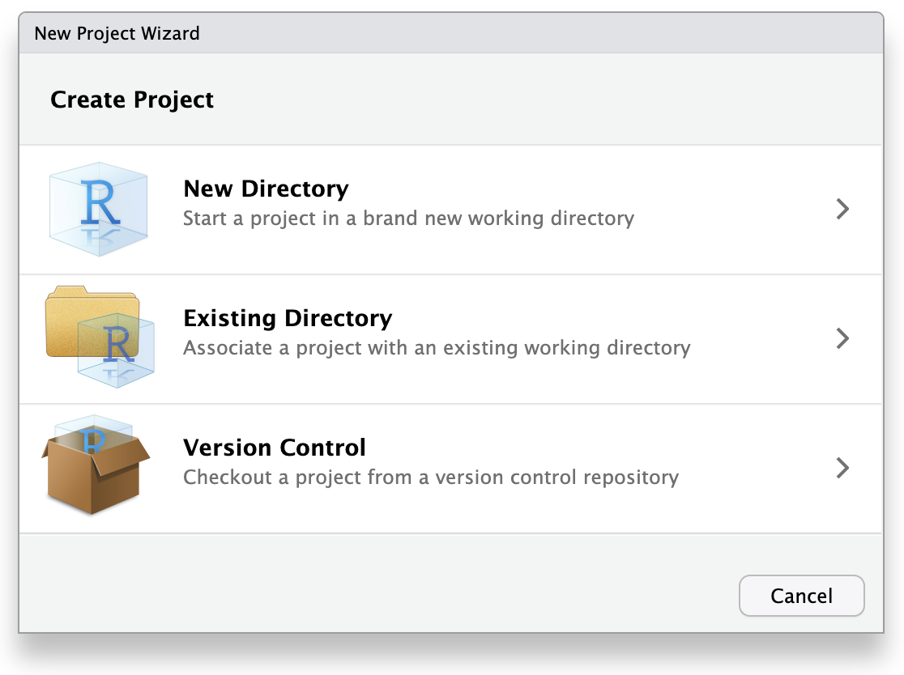
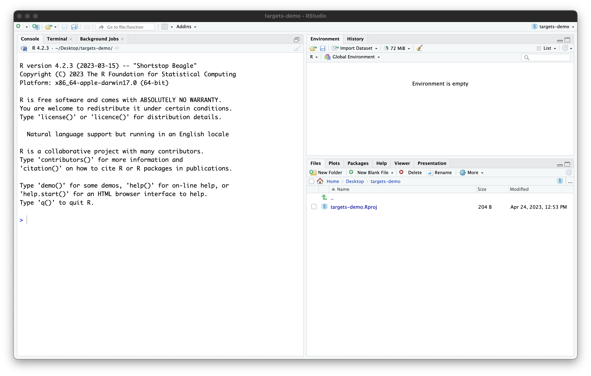

:::::::::::::::::::::::::::::::::::::: questions 

- 分析を整理するためのベストプラクティスは何ですか？
- `_targets.R` ファイルは何のためのものですか？
- `_targets.R` ファイルの内容は何ですか？
- ワークフローを実行するにはどうしますか？ 

::::::::::::::::::::::::::::::::::::::::::::::::

::::::::::::::::::::::::::::::::::::: objectives

- RStudioでプロジェクトを作成する
- `_targets.R` ファイルの目的を説明する
- 基本的な `_targets.R` ファイルを書く
- `_targets.R` ファイルを使用してワークフローを実行する

::::::::::::::::::::::::::::::::::::::::::::::::

::::::::::::::::::::::::::::::::::::: {.instructor}

エピソードの概要: 非常にシンプルなワークフローを書いて、初めて実際に手を動かしてみる機会

:::::::::::::::::::::::::::::::::::::


## プロジェクトの作成

### プロジェクトについて

`targets` は分析を整理するために「プロジェクト」の概念を使用します。特定のプロジェクトに必要なすべてのファイルを1つのフォルダ、プロジェクトフォルダにまとめます。

プロジェクトフォルダには、データ、コード、結果用のフォルダなど、整理のための追加のサブフォルダがあります。

プロジェクトを使用することで、他の作業に時間を費やした後に分析に戻った際に、簡単に再び方向付けることができます。

もし一度に1つの作業のみを完了させる場合は問題になりませんが、実際にはほとんどの場合そうではありません。

他の作業をした後にプロジェクトに戻るときに、何をしていたかを覚えておくのは難しいです（「コンテキストスイッチング」と呼ばれる現象）。

標準化された整理システムを使用することで、混乱や時間の浪費を減らすことができます。つまり、再現性を高めることになります！

このワークショップでは、プロジェクトの整理概念ともうまく連携する RStudio を使用します。

### RStudioでプロジェクトを作成する

RStudioを使用して新しいプロジェクトを開始しましょう。

「ファイル」をクリックし、「新しいプロジェクト」を選択します。

これにより、新しいプロジェクトウィザードが開き、プロジェクトの設定を手助けする一連のメニューが表示されます。

{alt="RStudioの新しいプロジェクトウィザードメニューのスクリーンショット"}

ウィザードで最初のオプション「新しいディレクトリ」をクリックします。これは、新しいプロジェクトをゼロから作成するためです。

次のメニューで「新しいプロジェクト」をクリックします。

「ディレクトリ名」には、プロジェクトの目的を思い出しやすい名前を入力します。例えば「targets-demo」（ファイルやフォルダの命名のベストプラクティスに従ってください）。

「プロジェクトをサブディレクトリとして作成する...」の下で、「参照」ボタンをクリックしてプロジェクトを配置するディレクトリを選択します。

プロジェクトを簡単に見つけられるように、デスクトップに配置することをお勧めします。

「Gitリポジトリを作成」と「このプロジェクトで renv を使用する」はチェックを外したままにできますが、これらは再現性を向上させる優れたツールです。もしまだであれば、将来的に学習して使用することを検討してください。

これらは後からでも有効にできるため、すぐに使用しようと心配する必要はありません。

これらの手順を進めると、RStudioのセッションは次のようになります：

{alt="新しく作成された 'targets-demo' プロジェクトが開かれ、1つのファイル 'targets-demo.Rproj' を含むRStudioのスクリーンショット"}

プロジェクトには現在、RStudioによって作成された1つのファイル `targets-demo.Rproj` が含まれています。このファイルを手動で編集しないでください。その目的は、RStudioにこのフォルダがプロジェクトフォルダであることを伝え、いくつかのRStudio設定を保存することです（バージョン管理ソフトウェアを使用している場合は、このファイルをコミットしても構いません）。また、ファイルエクスプローラーで `.Rproj` ファイルをダブルクリックすることでプロジェクトを開くことができます（RStudioを終了してからファイルブラウザでデスクトップに移動し、「targets-demo」フォルダを開いて `targets-demo.Rproj` をダブルクリックして試してください）。

さて、プロジェクトが設定されたので、`targets` を（ほぼ）使い始める準備ができました！

## 背景: `targets` を使用しないバージョン

まず、使用する関数やパッケージに慣れるために、`targets` を使用せずに「通常の」Rスクリプトのようにコードを実行してみましょう。

データを取得するために `palmerpenguins` Rパッケージを使用していることを思い出してください。

このパッケージには実際にデータセットの2つのバリエーションが含まれています。1つは生データを含む外部CSVファイルで、もう1つはRに読み込まれたクリーンなデータです。

実際のところ、生データは外部に保存されていることが多いため、**生のペンギンデータ** を分析の出発点として使用しましょう。

`palmerpenguins` の `path_to_file()` 関数は、生データCSVファイルへのパスを提供します（これは、パッケージをインストールしたときにコンピュータにダウンロードされた `palmerpenguins` Rパッケージのソースコード内にあります）。


``` r
library(palmerpenguins)
```

``` output

Attaching package: 'palmerpenguins'
```

``` output
The following objects are masked from 'package:datasets':

    penguins, penguins_raw
```

``` r
# Get path to CSV file
penguins_csv_file <- path_to_file("penguins_raw.csv")

penguins_csv_file
```

``` output
[1] "/home/runner/.local/share/renv/cache/v5/linux-ubuntu-jammy/R-4.6/x86_64-pc-linux-gnu/palmerpenguins/0.1.1/6c6861efbc13c1d543749e9c7be4a592/palmerpenguins/extdata/penguins_raw.csv"
```

データの読み込みと操作には、`tidyverse` パッケージ群を使用します。

今は `tidyverse` の使用方法のすべての詳細をカバーする時間がありませんが、詳細を学びたい場合は、["tidyverse を使用したデータの操作、分析、およびエクスポート" レッスン](https://datacarpentry.org/R-ecology-lesson/03-dplyr.html)、または Carpentry Incubator のレッスン [R and the tidyverse for working with datasets](https://carpentries-incubator.github.io/r-tidyverse-4-datasets/) を参照してください。

`read_csv()` を使用してデータを読み込みましょう。


``` r
library(tidyverse)

# Read CSV file into R
penguins_data_raw <- read_csv(penguins_csv_file)

penguins_data_raw
```


``` output
Rows: 344 Columns: 17
── Column specification ────────────────────────────────────────────────────────
Delimiter: ","
chr  (9): studyName, Species, Region, Island, Stage, Individual ID, Clutch C...
dbl  (7): Sample Number, Culmen Length (mm), Culmen Depth (mm), Flipper Leng...
date (1): Date Egg

ℹ Use `spec()` to retrieve the full column specification for this data.
ℹ Specify the column types or set `show_col_types = FALSE` to quiet this message.
```

``` output
# A tibble: 344 × 17
   studyName `Sample Number` Species         Region Island Stage `Individual ID`
   <chr>               <dbl> <chr>           <chr>  <chr>  <chr> <chr>          
 1 PAL0708                 1 Adelie Penguin… Anvers Torge… Adul… N1A1           
 2 PAL0708                 2 Adelie Penguin… Anvers Torge… Adul… N1A2           
 3 PAL0708                 3 Adelie Penguin… Anvers Torge… Adul… N2A1           
 4 PAL0708                 4 Adelie Penguin… Anvers Torge… Adul… N2A2           
 5 PAL0708                 5 Adelie Penguin… Anvers Torge… Adul… N3A1           
 6 PAL0708                 6 Adelie Penguin… Anvers Torge… Adul… N3A2           
 7 PAL0708                 7 Adelie Penguin… Anvers Torge… Adul… N4A1           
 8 PAL0708                 8 Adelie Penguin… Anvers Torge… Adul… N4A2           
 9 PAL0708                 9 Adelie Penguin… Anvers Torge… Adul… N5A1           
10 PAL0708                10 Adelie Penguin… Anvers Torge… Adul… N5A2           
# ℹ 334 more rows
# ℹ 10 more variables: `Clutch Completion` <chr>, `Date Egg` <date>,
#   `Culmen Length (mm)` <dbl>, `Culmen Depth (mm)` <dbl>,
#   `Flipper Length (mm)` <dbl>, `Body Mass (g)` <dbl>, Sex <chr>,
#   `Delta 15 N (o/oo)` <dbl>, `Delta 13 C (o/oo)` <dbl>, Comments <chr>
```

生データにはスペースを含む扱いにくい列名があり（これらはタイプミスしやすくコードのミスにつながりやすい）、必要なものよりもはるかに多くの列があります。

この分析の目的では、種名、くちばしの長さ、くちばしの深さのみが必要です。

生データでは、「culmen」というやや技術的な用語がくちばしを指すために使用されています。


下流の分析で使用しやすくするためにデータを整理しましょう。

後で一部の関数でエラーを引き起こす可能性があるため、欠損データを含む行も削除します。


``` r
# Clean up raw data
penguins_data <- penguins_data_raw |>
  # Rename columns for easier typing and
  # subset to only the columns needed for analysis
  select(
    species = Species,
    bill_length_mm = `Culmen Length (mm)`,
    bill_depth_mm = `Culmen Depth (mm)`
  ) |>
  # Delete rows with missing data
  drop_na()

penguins_data
```

``` output
# A tibble: 342 × 3
   species                             bill_length_mm bill_depth_mm
   <chr>                                        <dbl>         <dbl>
 1 Adelie Penguin (Pygoscelis adeliae)           39.1          18.7
 2 Adelie Penguin (Pygoscelis adeliae)           39.5          17.4
 3 Adelie Penguin (Pygoscelis adeliae)           40.3          18  
 4 Adelie Penguin (Pygoscelis adeliae)           36.7          19.3
 5 Adelie Penguin (Pygoscelis adeliae)           39.3          20.6
 6 Adelie Penguin (Pygoscelis adeliae)           38.9          17.8
 7 Adelie Penguin (Pygoscelis adeliae)           39.2          19.6
 8 Adelie Penguin (Pygoscelis adeliae)           34.1          18.1
 9 Adelie Penguin (Pygoscelis adeliae)           42            20.2
10 Adelie Penguin (Pygoscelis adeliae)           37.8          17.1
# ℹ 332 more rows
```

完全な分析はまだ実行していませんが、これで `targets` を使用する形に移行する準備は十分です。

## `targets` バージョン

### `_targets.R` ファイルについて

典型的なRのデータ分析と `targets` プロジェクトの大きな違いの一つは、後者にはメインプロジェクトフォルダ（「プロジェクトルート」）に特別なファイル `_targets.R` を含める必要があることです。

`_targets.R` ファイルにはワークフローの仕様が含まれており、Rに分析を実行させるための指示が記述されています。これはレシピのようなものです。
`_targets.R` ファイルを使用することで、**特定のスクリプトを特定の順序で実行することを覚えておく必要がなくなります**。代わりに、Rがそれを自動的に実行してくれます！
これは、将来の自分自身にとっても、分析を再現しようとする他の人にとっても、**非常に大きな利点**です。

### 最初の `_targets.R` ファイルの作成

これから `_targets.R` ファイルの作成を開始します。幸い、`targets` にはこれを手助けする関数が用意されています。

Rコンソールで、まず `library(targets)` で `targets` パッケージを読み込み、次に `tar_script()` コマンドを実行します。


``` r
library(targets)
tar_script()
```

コンソールでは何も起こりませんが、ファイルビューアに新しいファイル `_targets.R` が表示されます。ファイルメニューを使用するか、クリックして開いてください。

```{.r}
library(targets)
# This is an example _targets.R file. Every
# {targets} pipeline needs one.
# Use tar_script() to create _targets.R and tar_edit()
# to open it again for editing.
# Then, run tar_make() to run the pipeline
# and tar_read(data_summary) to view the results.

# Define custom functions and other global objects.
# This is where you write source(\"R/functions.R\")
# if you keep your functions in external scripts.
summarize_data <- function(dataset) {
  colMeans(dataset)
}

# Set target-specific options such as packages:
# tar_option_set(packages = "utils") # nolint

# End this file with a list of target objects.
list(
  tar_target(data, data.frame(x = sample.int(100), y = sample.int(100))),
  tar_target(data_summary, summarize_data(data)) # Call your custom functions.
)
```

このファイルの細部は気にしなくて大丈夫です。
その代わりに、3つの主要な部分が含まれていることに注目してください：

- `library()` を使用したパッケージの読み込み
- `function()` を使用したカスタム関数の定義
- `list()` を使用したリストの定義

`function()` を使ったことがない方もいるかもしれません。
その場合も問題ありません。[次のエピソード](episodes/functions.Rmd)で詳しく扱うので、今は無視してください。

最後の部分であるリストは、`_targets.R` ファイルの中で**最も重要な部分**です。
ワークフローのステップを定義します。
`_targets.R` ファイルは**常にこのリストで終わらなければなりません**。

さらに、リスト内の各項目は `tar_target()` 関数の呼び出しです。
`tar_target()` の最初の引数はビルドするターゲットの名前で、2番目の引数はそれをビルドするために使用するコマンドです。
ターゲットの名前は**引用符なし**、つまり、引用符で囲まれていないことに注意してください。

## 例示分析を実行するための `_targets.R` の修正

まず、ワークフローに必要なパッケージをすべて読み込みましょう。
`_targets.R` の先頭、`library(targets)` の後に `library(tidyverse)` と `library(palmerpenguins)` を追加します。

次に、`function()` 文は今はまだ使わないので削除できます（カスタム関数についてはすぐ後で扱います！）。

最後の、そして最も難しい部分は、ファイル末尾のリストでワークフローを正しく定義することです。

[`targets` を使用しないバージョン](#背景-targets-を使用しないバージョン)から、ここまでに3つのステップがあることがわかります：

1. 生のペンギンデータを含むCSVファイルへのパスを定義する。
2. CSVファイルを読み込む。
3. 生データをクリーニングする。

これらはそれぞれリストの1つの項目になります。
さらに、各項目は `tar_target()` 関数を使用して書く必要があります。
`tar_target()` 関数は、**ビルドするターゲットの名前**を最初に、**それをビルドするコマンド**を2番目に書くことを思い出してください。

::::::::::::::::::::::::::::::::::::: {.callout}

## 適切なターゲット名の選び方

各ターゲットの名前は自由に決めて構いませんが、**ターゲットが実際に何を含んでいるかを反映した名前を選ぶ**ことを強くお勧めします。

たとえば、CSVファイルから読み込んだ生データには `x` ではなく `penguins_data_raw` という名前を付けます。

将来の自分自身が感謝するでしょう！

::::::::::::::::::::::::::::::::::::::::::

::::::::::::::::::::::::::::::::::::: {.challenge}

## チャレンジ: `tar_target()` を使ってみよう

`tar_target()` を使って、ワークフローの最初のステップ（ペンギンデータを含むCSVファイルへのパスの設定）を定義できますか？

:::::::::::::::::::::::::::::::::: {.solution}


``` r
tar_target(name = penguins_csv_file, command = path_to_file("penguins_raw.csv"))
```

`tar_target()` の最初の2つの引数は、ターゲットの**名前**と、それをビルドする**コマンド**です。

これらの引数は頻繁に使用されるため、通常は引数名を省略して、次のように書きます：


``` r
tar_target(penguins_csv_file, path_to_file("penguins_raw.csv"))
```

::::::::::::::::::::::::::::::::::

::::::::::::::::::::::::::::::::::::::::::

最初のターゲットの定義方法がわかったので、続けて残りを追加しましょう。

追加し終えると、`_targets.R` は次のようになるはずです：


``` r
library(targets)
library(tidyverse)
library(palmerpenguins)

list(
  tar_target(penguins_csv_file, path_to_file("penguins_raw.csv")),
  tar_target(
    penguins_data_raw,
    read_csv(penguins_csv_file, show_col_types = FALSE)
  ),
  tar_target(
    penguins_data,
    penguins_data_raw |>
      select(
        species = Species,
        bill_length_mm = `Culmen Length (mm)`,
        bill_depth_mm = `Culmen Depth (mm)`
      ) |>
      drop_na()
  )
)
```

`read_csv()` で `show_col_types = FALSE` に設定したのは、先ほどのコードから列の型がデフォルトで正しく設定されている（種には文字列、くちばしの長さと深さには数値）ことがわかっているためです。したがって、通常発生する警告を表示する必要はありません。

## ワークフローの実行

ワークフローができたので、`tar_make()` 関数を使用して実行できます。

それを実行してみてください。次のようなものが表示されるはずです：


``` r
tar_make()
```

``` output

Attaching package: ‘palmerpenguins’

The following objects are masked from ‘package:datasets’:

    penguins, penguins_raw

+ penguins_csv_file dispatched
✔ penguins_csv_file completed [1ms, 191 B]
+ penguins_data_raw dispatched
✔ penguins_data_raw completed [99ms, 10.40 kB]
+ penguins_data dispatched
✔ penguins_data completed [14ms, 1.61 kB]
✔ ended pipeline [348ms, 3 completed, 0 skipped]
```

おめでとうございます、`targets` を使って最初のワークフローを実行しました！

::::::::::::::::::::::::::::::::::::: {.callout}

## ワークフローは対話的に実行できません

RStudioなどのIDEで、行を選択して「Run」ボタン（またはキーボードショートカット）を押すことで、Rコードを対話的に実行することに慣れているかもしれません。

`_targets.R` の末尾にあるリストをこの方法で実行することも*できます*が、ワークフローは実行されません（代わりにリストが返されます）。

**ワークフローを実行する唯一の方法は `tar_make()` です。**

`_targets.R` の中で何かを選択して対話的に実行する必要はありません。
実際、`tar_make()` でワークフローを実行するために `_targets.R` ファイルを開いておく必要すらありません---ぜひ自分で試してみてください！

同様に、**`_targets.R` ファイルに `tar_make()` を書いてはいけません**。`tar_make()` はRコンソールで直接コマンドとして使用するだけにしてください。

::::::::::::::::::::::::::::::::::::::::::

覚えておいてください。`targets` を使用している今、**分析を再現するために必要なのは `tar_make()` を実行することだけです**。

これは、分析がどれだけ長く複雑になっても変わりません。

::::::::::::::::::::::::::::::: keypoints 

- プロジェクトは分析を整理しておくのに役立ち、後で簡単に再実行できます
- RStudioのプロジェクトウィザードを使用してプロジェクトを作成する
- `_targets.R` ファイルはすべての `targets` プロジェクトに含める必要がある特別なファイルであり、ワークフローを定義します
- `tar_script()` を使用してデフォルトの `_targets.R` ファイルを作成する
- `tar_make()` を使用してワークフローを実行する

:::::::::::::::::::::::::::::::::
